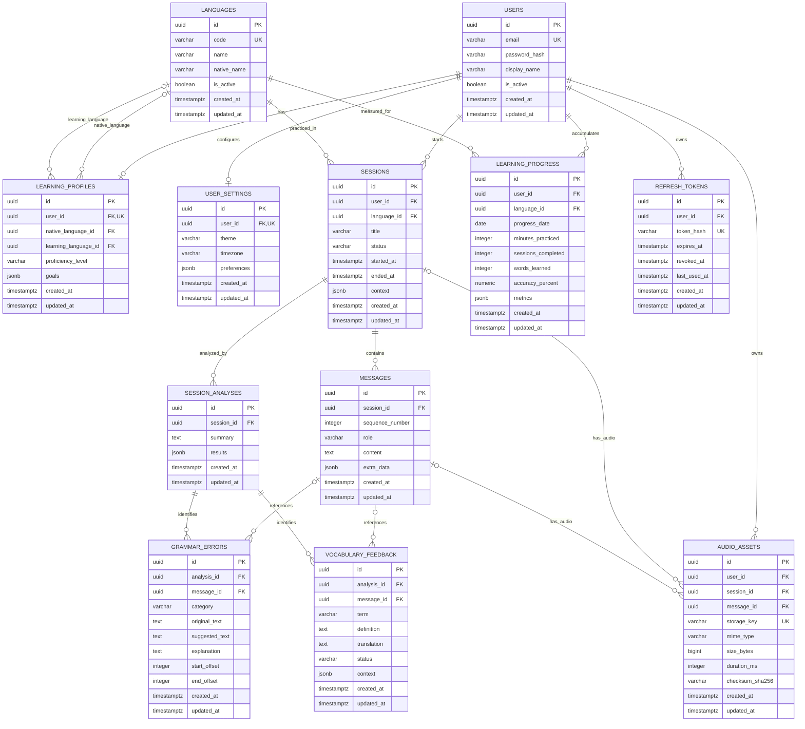

# LinguaAi PostgreSQL schema

This ERD describes the initial schema in `backend/app/models/` and its Alembic migration. It deliberately contains no business-specific tables beyond the requested learning entities.

## Relationship and deletion rules

- Each user can have zero or one learning profile and zero or one settings record. Deleting the user cascades to both.
- Users can have many sessions, progress records, refresh-token records, and audio-asset records. Deleting a user cascades to those records.
- A learning profile may reference a native language and a learning language. Those references are nullable and become `NULL` if a catalog language is deleted.
- Each session belongs to exactly one user and one language. Deleting a user cascades to their sessions; deleting a referenced language is restricted.
- A session contains zero or many ordered messages and zero or many analysis runs. Deleting a session cascades to its messages, analyses, and linked audio metadata.
- An analysis belongs to one session and may identify many grammar errors and vocabulary feedback entries. Deleting the analysis cascades to those findings.
- A finding may reference zero or one message. Deleting a message preserves the finding but clears its message reference.
- Each daily progress record belongs to one user and one language. The `(user_id, language_id, progress_date)` combination is unique; language deletion is restricted while progress refers to it.
- Refresh-token records store a unique token hash, never the raw token. They belong to one user and are deleted with that user.
- Audio assets belong to one user and may be linked to a session or message. PostgreSQL stores metadata and an external `storage_key`, not audio binary data.

Unique constraints protect user email, language code, the one-to-one profile/settings user references, per-session message order, refresh-token hashes, audio storage keys, and daily progress aggregates. Foreign keys and commonly filtered parent/date fields are indexed.
